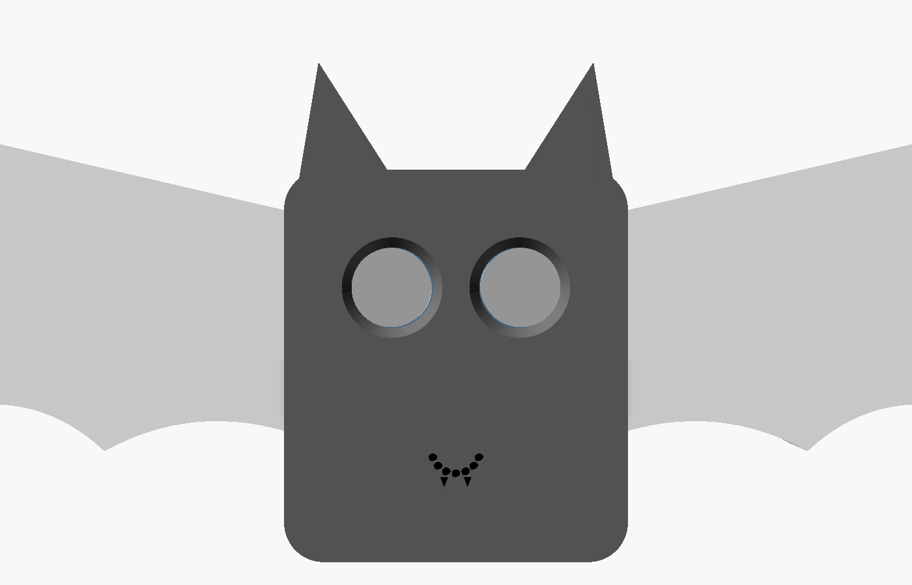

# The Bat That Sees With Sound: build guide



## 1. Parts

| Part | Qty | Notes |
|---|---|---|
| Arduino Nano v3 (mini USB) | 1 | Wires are soldered on. Works with or without header pins. |
| HC-SR04 | 1 | The HC-SR04P (3–5.5 V) has the same size and also works. |
| RGBW NeoPixel strip (SK6812, separate white chip), 60 LED/m | **10 LEDs** | Cut **two pieces of 5 LEDs** (about 83 mm each). For a plain RGB strip, set `PIXEL_TYPE` to `NEO_GRB` in the sketch. |
| Buzzer, 12 mm round | 1 | Passive is best. Active also works (set one line in the code). |
| Resistor 330 Ω | 2 | One in each LED data line. |
| Resistor 150 Ω | 1 | Only for a passive buzzer. |
| Capacitor 470 µF, 6.3 V or higher | 1 | Recommended: across 5V/GND where the LED wires start. |
| M3 × 10 screws (self-tapping into plastic) | 3 | Hold the lid on. |
| M3 × 12 screws | 2 | Hold the sensor clamp. |
| Thin wire (AWG 26–28) | ~1 m | Use 3 colours if you can: 5V, GND, signal. |
| Glue (CA / superglue) | – | For the wing tabs, wing back plates and buzzer. |
| Mini-USB cable + 5 V USB charger (≥ 0.5 A) or power bank | 1 | This is the only power supply. |

**Power check:** 10 LEDs are limited by the code to about 150 mA. With the Nano, sensor and buzzer the total is about 250 mA, well inside what a USB port gives (500 mA). Do not raise `BRIGHT_MAX` above about 200.

## 2. Cutting the LED strip
- Cut only through the middle of the copper pads (the line with the scissors mark). On a 60/m strip every LED has its own cut line.
- Count **5 LEDs** and cut. Do it twice.
- The small arrows on the strip show the data direction. **The DIN end goes at the body (wing root), and the arrows point toward the wing tip.**

## 3. Wiring

```
                 Arduino Nano
               ┌──────────────┐
  HC-SR04 VCC ─┤ 5V           │
  HC-SR04 GND ─┤ GND          │
  HC-SR04 TRIG ┤ D9           │
  HC-SR04 ECHO ┤ D10          │
                │              │
  buzzer + ──[150Ω]── D3       │   (active buzzer: no resistor, + to D3)
  buzzer − ─────────── GND     │
                │              │
         ┌─[330Ω]── D6 ──[330Ω]─┐
         │      └──────────────┘ │
   LEFT wing DIN            RIGHT wing DIN
   LEFT wing 5V  ── 5V ──  RIGHT wing 5V      (470µF across 5V/GND near the Nano, + to 5V)
   LEFT wing GND ── GND ── RIGHT wing GND
```

- **Both wings share one data pin (D6).** They show exactly the same thing, mirrored. That keeps the wiring short and needs no wire from wing tip to wing tip.
- Put each 330 Ω resistor near the Nano, one in each data wire.
- The Nano's 5V pin gives USB power. Every 5V wire goes there.
- Make the wing wires about 15 cm long. They run from the strip start, down inside the wing, through the tab, into the body.

## 4. Printing (Voron Switchwire, 250 × 210 bed)

| File | Colour | Orientation (already set in the STL) | Notes |
|---|---|---|---|
| `cad/body.stl` | any (e.g. black) | face down | No supports. 3 walls, 15–20 % infill. |
| `cad/lid.stl` | same as body | outer face down | No supports. |
| `cad/clamp.stl` | any | flat | No supports. |
| `cad/wing_shell_R.stl`, `wing_shell_L.stl` | **white PLA** | face down | The front skin is **1.0 mm** thick and lets the light through. Print it with 100 % infill (solid) or the infill pattern will show when lit. No supports. |
| `cad/wing_back_R.stl`, `wing_back_L.stl` | any, white is brightest | flat | The rails face up. |

Layer height 0.2 mm, 0.4 mm nozzle. Both wings fit on the bed together.

Sizes: body 70 × 102 (with ears) × 52 mm deep; wingspan about 294 mm.

## 5. Assembly
1. **Buzzer:** press it into the round pocket behind the mouth, sound hole toward the face. Add a drop of glue.
2. **HC-SR04:** push the two "eyes" through the eye holes from the inside until the board rests on the four corner stops. Put the **clamp** across the back of the board (the thicker ends press on the board ends) and screw it on with 2 × M3 × 12. Do not overtighten.
3. **Nano:** solder all wires first. Then slide the board in from the back, lying flat, components up, USB toward the back. Its front end goes into the two slotted pillars beside the buzzer.
4. **Wings:** stick each 5-LED strip between the rails on a wing back plate (DIN end at the root, next to the tab). Pass the 3 wires through the tab. Put the back plate into the white shell; it rests on the inner ledge. Hold it with 3–4 dots of glue on the edge.
5. Push each wing tab into the slot in the body side. Thread the wires inside and solder them to the Nano. When everything works, glue the tabs.
6. **Lid:** the two fins with notches on the lid hold the USB end of the Nano. Fit the lid so the USB socket lines up with the lid's opening, then use 3 × M3 × 10 screws.
7. Plug in USB. It stands on a table or shelf. If the cable tips it over, add rubber feet or a coin glued inside the bottom.

## 6. Software
1. In the Arduino IDE, install the **Adafruit NeoPixel** library (Library Manager). You already have it.
2. Open `BatSonar/BatSonar.ino`.
3. Board: **Arduino Nano**. Processor: **ATmega328P (Old Bootloader)** (most clones). If the upload fails, try the plain **ATmega328P**.
4. If you have an **active** buzzer, set `#define BUZZER_PASSIVE 0`.
   - How to tell: connect the buzzer to 5V and GND for a moment. If it beeps on its own, it is active. If it only clicks, it is passive. Passive ones usually show a green circuit board underneath; active ones are sealed with black resin.

What it does:

| Child distance | Lights | Sound |
|---|---|---|
| > 2 m or nobody | soft green "breathing" | silent |
| 2 m → 1.1 m | green → yellow | slow chirps, low pitch |
| 1.1 m → 25 cm | yellow → red, brighter | faster chirps, higher pitch |
| < 25 cm | bright red | rapid chirps |

Each chirp sends a ripple of light with a white sparkle from the body out to the wing tips. `RIPPLE_WHITE` sets how bright the sparkle is; 0 turns it off. If red and green look swapped, change `PIXEL_TYPE` to `NEO_RGBW`. If nothing moves for 20 s (for example the bat faces a sofa), it goes back to resting and stays quiet.

Everything you can tune is at the top of the sketch: `FAR_CM`, `NEAR_CM`, `BEEP_SLOW_MS`, `BEEP_FAST_MS`, pitches, brightness, `STILL_TIMEOUT_MS`, and `SOUND_ENABLED`.

## 7. Changing the case
`cad/bat_enclosure.scad` is parametric. Open it in OpenSCAD and change the values at the top: `eye_x` if your sensor's eye spacing isn't 26 mm, `nano_w`, `strip_w`, the wing points, and so on. Then export a part:
```
openscad -D "part=\"body\"" -o body.stl bat_enclosure.scad
```
Part names: `body`, `lid`, `clamp`, `wing_shell_R`, `wing_shell_L`, `wing_back_R`, `wing_back_L`, `assembly` (preview only).
