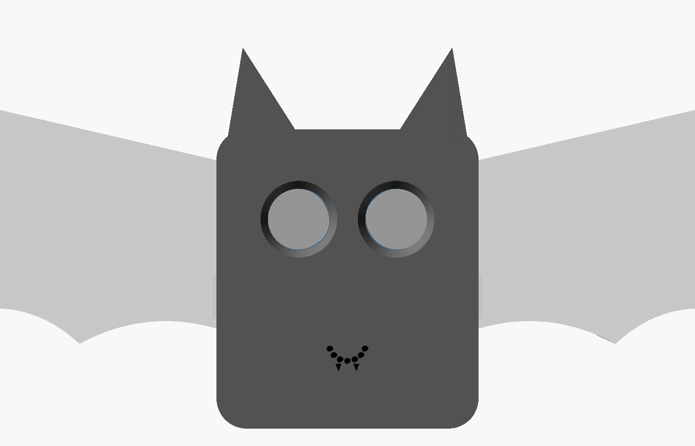

# The Bat That Sees With Sound



A 3D-printed bat for children. Its "eyes" are an HC-SR04 ultrasonic sensor. As a child walks toward it, the glowing wings go **green → yellow → red** and the bat chirps faster and higher, like a real bat using echoes to find its way.

You can also **scratch the bat's head** (a touch button): it gets happy and shows a rainbow. A **double-tap** turns the chirping off or on.

Hardware: Arduino Nano v3 (mini USB), HC-SR04, 2 × 5 RGBW NeoPixels (60 LED/m), 12 mm buzzer, TTP223 capacitive touch button. Powered only by the mini-USB cable.

## How it behaves

### At power-up
1. **Rainbow (3.5 s):** the colours of the rainbow flow out along both wings.
2. **"Hello" animation:** the light runs out to the wing tips three times, first green, then yellow, then red, with three rising chirps (silent if chirping is turned off).
3. Then the bat starts **resting**.

Don't touch the button while the bat powers up: the touch chip calibrates itself in the first moment.

### Resting (nobody around)
- The wings **breathe slowly in green**: dim, a little brighter, dim again, over 4 seconds.
- **No sound.**
- It rests when nothing is closer than **1 m**. Anything further away counts as nobody there.

### Someone approaching
Both wings always show the same thing. As the child gets closer, the colour, brightness, chirp speed and chirp pitch all change smoothly together:

| Distance | Colour | Brightness | Time between chirps | Pitch |
|---|---|---|---|---|
| just under 1 m | green | 70 | 0.9 s | 1800 Hz (low) |
| 80 cm | yellow-green | 91 | 0.68 s | 2330 Hz |
| **62 cm** | **yellow** | 110 | 0.49 s | 2800 Hz |
| 45 cm | orange | 129 | 0.31 s | 3270 Hz |
| 33 cm | red-orange | 141 | 0.18 s | 3590 Hz |
| **25 cm or less** | **red** | 150 | 0.09 s (about 11 chirps per second) | 3800 Hz (high) |

Brightness runs from 0 to 255; the code stops at 150 so the USB supply isn't overloaded. Each chirp is a short 35 ms "tsk". With an active buzzer the pitch doesn't change, only the speed.

### The light ripple
Every chirp sends a **wave of light from the body out to the wing tips**. Each LED flashes brighter for a moment, one after the other, 30 ms apart, with a small **white sparkle** from the white chip. It looks like the sound flying out of the bat. Far away the ripples are slow and calm; up close they come so fast the wings seem to flicker.

### Touch: scratching and chirping off/on
- **Scratch (any touch):** the bat is happy. The wings show a **flowing rainbow** for **4 seconds**, with a short **happy trill** (passive buzzer only, and only if chirping is on). Keep touching and it stays happy for as long as you touch, plus 4 s. No chirps play during the rainbow; afterwards the bat carries on as before.
- **Double-tap (exactly 2 quick taps):** turns **chirping off or on**.
  - Off: 2 **blue** flashes and 2 **low** beeps.
  - On: 2 **white** flashes and 2 **high** beeps.
  - The setting is **remembered after unplugging**. While chirping is off, the lights still work and the ripples keep the rhythm silently.
- A tap is a touch shorter than 0.4 s, and the 2 taps must come within 0.45 s of each other. **Three or more quick taps count as scratching**, so a child scratching away won't mute the bat by accident.

### Ignoring things that don't move
If the distance stays within **8 cm** for **20 seconds**, the bat decides it's looking at furniture or a wall. It goes quiet and back to green breathing. As soon as something moves more than 8 cm, it wakes up again. A child who stands perfectly still in front of it for 20 s also sends it back to "sleep", so moving wakes it, which can become part of the game.

### Smoothing the readings
- The sensor measures about **16 times per second**.
- Each reading is the middle value of the last three, which throws away odd one-off echoes.
- That value is then smoothed, so the colour glides instead of jumping.
- When someone first appears, or leaves the 1 m range, the bat reacts **immediately**, with no fade.

### What you can tune
All of these are at the top of [BatSonar.ino](BatSonar.ino):

| Setting | Now | What it changes |
|---|---|---|
| `FAR_CM` / `NEAR_CM` | 100 / 25 | Where reacting starts (further = relaxed) / where it's fully red |
| `BEEP_SLOW_MS` / `BEEP_FAST_MS` | 900 / 90 | Chirp speed far away / close up |
| `PITCH_LOW_HZ` / `PITCH_HIGH_HZ` | 1800 / 3800 | Chirp pitch range |
| `CHIRP_MS` | 35 | Length of each chirp |
| `BRIGHT_MIN` / `BRIGHT_MAX` / `BRIGHT_IDLE_MAX` | 70 / 150 / 40 | Brightness (keep the max at 200 or less) |
| `RIPPLE_WHITE` | 60 | White sparkle strength (0 = off) |
| `STILL_TIMEOUT_MS` / `STILL_BAND_CM` | 20 s / 8 cm | When it decides nothing is moving |
| `SOUND_ENABLED` | 1 | 0 = lights only, silent bat |
| `START_RAINBOW_MS` | 3500 | Length of the rainbow at power-up |
| `HAPPY_MS` | 4000 | How long the rainbow lasts after a scratch |
| `RAINBOW_BRIGHT` / `RAINBOW_CYCLE_MS` | 110 / 1500 | Rainbow brightness / speed |
| `HAPPY_SOUND` | 1 | 0 = no happy trill on a scratch |
| `TAP_MAX_MS` / `DOUBLE_TAP_GAP_MS` | 400 / 450 | How quick a tap and a double-tap must be |
| `TOUCH_ACTIVE_HIGH` | 0 | 1 if the touch output goes HIGH while touched, 0 if it goes LOW. Wrong setting = the bat is happy all the time and calms down when touched |

---

# Build guide

## 1. Parts

| Part | Qty | Notes |
|---|---|---|
| Arduino Nano v3 (mini USB) | 1 | Wires are soldered on. Works with or without header pins. |
| HC-SR04 | 1 | The HC-SR04P (3–5.5 V) has the same size and also works. |
| RGBW NeoPixel strip (SK6812, separate white chip), 60 LED/m | **10 LEDs** | Cut **two pieces of 5 LEDs** (about 83 mm each). For a plain RGB strip, set `PIXEL_TYPE` to `NEO_GRB` in the sketch. |
| Buzzer, 12 mm round | 1 | Passive is best. Active also works (set one line in the code). |
| Resistor 330 Ω | 2 | One in each LED data line. |
| Resistor 220 Ω | 1 | Only for a passive buzzer. Keeps the pin current at about 20 mA. |
| Capacitive touch button, 3 pins (TTP223, GND / VCC / OUT) | 1 | Works through 1–2 mm of plastic, so it can be glued inside the top of the head. |
| Capacitor 470 µF, 6.3 V or higher | 1 | Recommended: across 5V/GND where the LED wires start. |
| M3 × 10 screws (self-tapping into plastic) | 3 | Hold the lid on. |
| M3 × 12 screws | 2 | Hold the sensor clamp. |
| Thin wire (AWG 26–28) | ~1 m | Use 3 colours if you can: 5V, GND, signal. |
| Glue (CA / superglue) | – | For the wing tabs, wing back plates and buzzer. |
| Mini-USB cable + 5 V USB charger (≥ 0.5 A) or power bank | 1 | This is the only power supply. |

**Power check:** 10 LEDs are limited by the code to about 150 mA. With the Nano, sensor and buzzer the total is about 250 mA, well inside what a USB port gives (500 mA). Do not raise `BRIGHT_MAX` above about 200.

## 2. Cutting the LED strip
- Cut only through the middle of the copper pads (the line with the scissors mark). On a 60/m strip every LED has its own cut line.
- Count **5 LEDs** and cut. Do it twice.
- The small arrows on the strip show the data direction. **The DIN end goes at the body (wing root), and the arrows point toward the wing tip.**

## 3. Wiring

```
                 Arduino Nano
               ┌──────────────┐
  HC-SR04 VCC ─┤ 5V           │
  HC-SR04 GND ─┤ GND          │
  HC-SR04 TRIG ┤ D9           │
  HC-SR04 ECHO ┤ D10          │
                │              │
  buzzer + ──[220Ω]── D3       │   (active buzzer: no resistor, + to D3)
  buzzer − ─────────── GND     │
                │              │
  touch OUT ───────── D2       │
  touch VCC ───────── 5V       │
  touch GND ───────── GND      │
                │              │
         ┌─[330Ω]── D6 ──[330Ω]─┐
         │      └──────────────┘ │
   LEFT wing DIN            RIGHT wing DIN
   LEFT wing 5V  ── 5V ──  RIGHT wing 5V      (470µF across 5V/GND near the Nano, + to 5V)
   LEFT wing GND ── GND ── RIGHT wing GND
```

- **Both wings share one data pin (D6).** They show exactly the same thing, mirrored. That keeps the wiring short and needs no wire from wing tip to wing tip.
- Put each 330 Ω resistor near the Nano, one in each data wire.
- The Nano's 5V pin gives USB power. Every 5V wire goes there.
- Make the wing wires about 15 cm long. They run from the strip start, down inside the wing, through the tab, into the body.

## 4. Printing (Voron Switchwire, 250 × 210 bed)

| File | Colour | Orientation (already set in the STL) | Notes |
|---|---|---|---|
| `cad/body.stl` | any (e.g. black) | face down | No supports. 3 walls, 15–20 % infill. |
| `cad/lid.stl` | same as body | outer face down | No supports. |
| `cad/clamp.stl` | any | flat | No supports. |
| `cad/wing_shell_R.stl`, `wing_shell_L.stl` | **white PLA** | face down | The front skin is **1.0 mm** thick and lets the light through. Print it with 100 % infill (solid) or the infill pattern will show when lit. No supports. |
| `cad/wing_back_R.stl`, `wing_back_L.stl` | any, white is brightest | flat | The rails face up. |

Layer height 0.2 mm, 0.4 mm nozzle. Both wings fit on the bed together.

Sizes: body 70 × 102 (with ears) × 52 mm deep; wingspan about 294 mm.

## 5. Assembly
1. **Buzzer:** press it into the round pocket behind the mouth, sound hole toward the face. Add a drop of glue.
2. **HC-SR04:** push the two "eyes" through the eye holes from the inside until the board rests on the four corner stops. Put the **clamp** across the back of the board (the thicker ends press on the board ends) and screw it on with 2 × M3 × 12. Do not overtighten.
3. **Nano:** solder all wires first. Then slide the board in from the back, lying flat, components up, USB toward the back. Its front end goes into the two slotted pillars beside the buzzer.
4. **Wings:** stick each 5-LED strip between the rails on a wing back plate (DIN end at the root, next to the tab). Pass the 3 wires through the tab. Put the back plate into the white shell; it rests on the inner ledge. Hold it with 3–4 dots of glue on the edge.
5. Push each wing tab into the slot in the body side. Thread the wires inside and solder them to the Nano. When everything works, glue the tabs.
6. **Touch button:** there's no holder in the case. Glue the module flat against the **inside of the top wall**, between the ears, with its touch pad facing the plastic (hot glue or double-sided tape). You can then "scratch the bat's head" through the 2 mm wall. If it reacts poorly through the plastic, mount it where the wall is thinner or glue it to the outside instead.
7. **Lid:** the two fins with notches on the lid hold the USB end of the Nano. Fit the lid so the USB socket lines up with the lid's opening, then use 3 × M3 × 10 screws.
8. Plug in USB. It stands on a table or shelf. If the cable tips it over, add rubber feet or a coin glued inside the bottom.

## 6. Software
1. In the Arduino IDE, install the **Adafruit NeoPixel** library (Library Manager). You already have it.
2. Open `BatSonar/BatSonar.ino`.
3. Board: **Arduino Nano**. Processor: **ATmega328P (Old Bootloader)** (most clones). If the upload fails, try the plain **ATmega328P**.
4. If you have an **active** buzzer, set `#define BUZZER_PASSIVE 0`.
   - How to tell: connect the buzzer to 5V and GND for a moment. If it beeps on its own, it is active. If it only clicks, it is passive. Passive ones usually show a green circuit board underneath; active ones are sealed with black resin.

5. **Strip type:** the sketch is set for an RGBW strip in GRBW order (`NEO_GRBW`). If far away looks red instead of green, red and green are swapped: set `PIXEL_TYPE` to `NEO_RGBW`. For a plain RGB strip use `NEO_GRB`.
6. **Touch module:** it must be **momentary**, meaning the output is on only while you touch. Some TTP223 boards come set to **latch** (each touch flips the output and it stays). That's set by a solder bridge on pad **B**; remove the bridge to make it momentary.

What the bat does once it's running is described in [How it behaves](#how-it-behaves) at the top.

## 7. Changing the case
`cad/bat_enclosure.scad` is parametric. Open it in OpenSCAD and change the values at the top: `eye_x` if your sensor's eye spacing isn't 26 mm, `nano_w`, `strip_w`, the wing points, and so on. Then export a part:
```
openscad -D "part=\"body\"" -o body.stl bat_enclosure.scad
```
Part names: `body`, `lid`, `clamp`, `wing_shell_R`, `wing_shell_L`, `wing_back_R`, `wing_back_L`, `assembly` (preview only).
