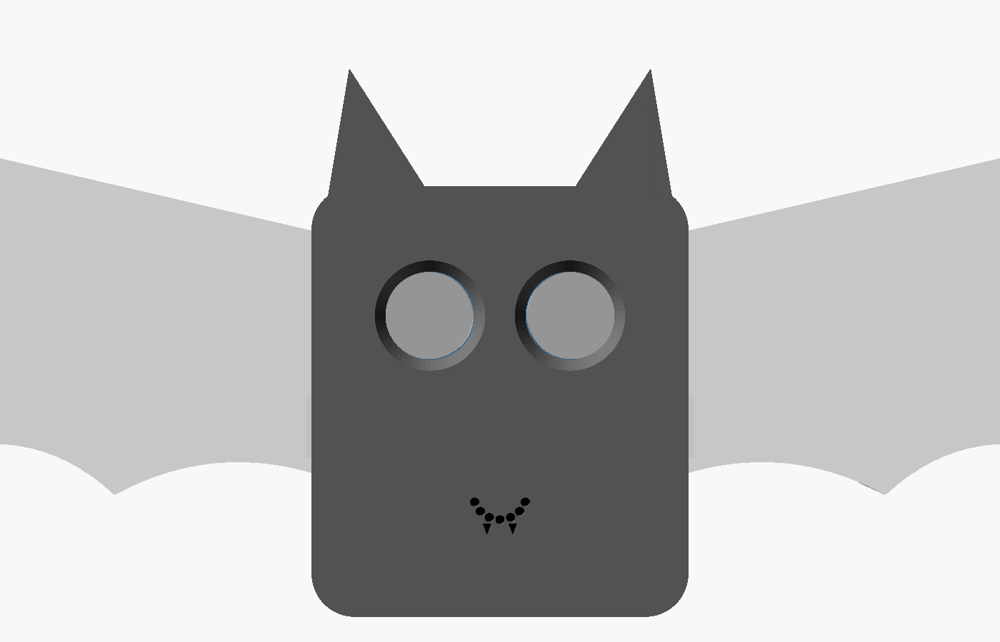

# Liliacul care vede cu sunete

🇬🇧 [Read in English](README.md)



Un liliac printat 3D pentru copii. „Ochii” lui sunt un senzor ultrasonic HC-SR04. Când un copil se apropie, aripile luminoase trec de la **verde → galben → roșu**, iar liliacul ciripește tot mai repede și mai subțire, ca un liliac adevărat care își găsește drumul cu ajutorul ecoului.

Liliacul poate fi și **scărpinat pe cap** (un buton tactil): se bucură și arată un curcubeu. **Două atingeri rapide** opresc sau pornesc ciripitul.

Liliacul are și o a doua stare: **liliacul speriat**. Îi e frică atunci când e singur, se liniștește când vine cineva aproape și nu-i place să fie scărpinat. **Șase atingeri rapide** schimbă între cele două stări.

Componente: Arduino Nano v3 (mini USB), HC-SR04, 2 × 5 LED-uri NeoPixel RGBW (60 LED/m), buzzer de 12 mm, buton tactil capacitiv TTP223. Alimentare doar prin cablul mini-USB.

## Cum se comportă

### La pornire
1. **Curcubeu (3,5 s):** culorile curcubeului curg de-a lungul ambelor aripi.
2. **Animația de „salut”:** lumina pleacă de trei ori spre vârful aripilor, cu trei ciripituri tot mai subțiri (fără sunet dacă ciripitul e oprit). Liliacul normal: verde, galben, roșu. Liliacul speriat: albastru, verde, galben. Așa vezi starea lui încă de la pornire.
3. Apoi liliacul începe să funcționeze.

Nu atinge butonul cât timp liliacul pornește: cipul tactil se calibrează singur în primele momente.

### Cele două stări
- `#define START_SCARED 0`, chiar la începutul programului: **0 = liliac normal**, **1 = liliac speriat**.
- **Șase atingeri rapide** schimbă starea. Vei vedea o lumină **mov** care aleargă de două ori spre vârful aripilor, cu o melodie care **urcă** (acum e speriat) sau care **coboară** (acum e normal). Melodia se aude și când ciripitul e oprit, ca să știi că a mers.
- Starea **rămâne ținută minte și după ce scoți cablul**. Dacă schimbi `START_SCARED` și încarci programul din nou, valoarea nouă are prioritate față de starea ținută minte.

## Liliacul normal

### Odihnă (nu e nimeni prin preajmă)
- Aripile **„respiră” încet în verde**: slab, puțin mai tare, din nou slab, în 4 secunde.
- **Fără sunet.**
- Se odihnește atunci când nu e nimic mai aproape de **2 m**. Tot ce e mai departe contează ca „nu e nimeni”.

### Se apropie cineva
Ambele aripi arată mereu același lucru. Pe măsură ce copilul se apropie, culoarea, luminozitatea, viteza și tonul ciripitului se schimbă lin, toate odată:

| Distanță | Culoare | Luminozitate | Pauză între ciripituri | Ton |
|---|---|---|---|---|
| puțin sub 2 m | verde | 70 | 0,9 s | 1800 Hz (gros) |
| 1,5 m | verde-gălbui | 93 | 0,67 s | 2370 Hz |
| **1,1 m** | **galben** | 110 | 0,49 s | 2800 Hz |
| 75 cm | portocaliu | 127 | 0,32 s | 3230 Hz |
| 40 cm | roșu-portocaliu | 143 | 0,16 s | 3630 Hz |
| **25 cm sau mai puțin** | **roșu** | 150 | 0,09 s (cam 11 ciripituri pe secundă) | 3800 Hz (subțire) |

Luminozitatea merge de la 0 la 255; programul se oprește la 150 ca să nu suprasolicite alimentarea USB. Fiecare ciripit e un „țâc” scurt de 35 ms. Cu un buzzer activ tonul nu se schimbă, doar viteza.

### Scărpinat
Liliacul se bucură: aripile arată un **curcubeu care curge**, cu un scurt **tril vesel** (doar cu buzzer pasiv și doar dacă ciripitul e pornit). Cu `HAPPY_MS 0`, curcubeul durează exact cât ții degetul pe buton. Pune de exemplu `4000` ca să mai țină 4 s după ce iei degetul. Cât timp e curcubeu, liliacul nu ciripește.

## Liliacul speriat

### Singur (nimeni la mai puțin de 2 m)
- **Aripi albastre, reci, care tremură**: fiecare LED pâlpâie neliniștit.
- **Scâncete rapide și subțiri** (cam 7 pe secundă), cu tonul tremurat de emoție.

### Se apropie cineva: se liniștește

| Distanță | Culoare | Luminozitate | Pauză între ciripituri | Ton |
|---|---|---|---|---|
| nimeni / peste 2 m | **albastru**, tremurat | 120 | 0,15 s | cam 3800 Hz (subțire, tremurat) |
| 1,5 m | albastru-verzui, tremură mai puțin | 103 | 0,51 s | 3230 Hz |
| **1,1 m** | **verde** | 90 | 0,78 s | 2800 Hz |
| 75 cm | verde-gălbui, aproape liniștit | 77 | 1,04 s | 2370 Hz |
| **25 cm sau mai puțin** | **galben blând, liniștit**, fără tremur | 60 | 1,4 s | 1800 Hz (gros) |

### Singur mult timp
După **20 s** singur, fără să se miște nimic, **obosește**: „respiră” slab în albastru, cu un ușor tremur, **fără sunet**. Orice mișcare la mai puțin de 2 m îl trezește (și se sperie din nou). Dacă cineva stă aproape, dar nu se mișcă 20 s, se liniștește de tot: „respiră” încet în culoarea în care era, fără sunet.

### Scărpinat: nu-i place
Cât timp e atins, aripile **clipesc repede în roșu și mov**, iar el **mormăie**: un „grrr” gros, care coboară (doar cu buzzer pasiv și doar dacă ciripitul e pornit), repetat cât timp îl scarpini. Cu `HAPPY_MS 0` se oprește imediat ce iei degetul.

## În ambele stări

### Valul de lumină
Fiecare ciripit trimite un **val de lumină de la corp spre vârful aripilor**. Fiecare LED se aprinde mai tare pentru o clipă, unul după altul, la 30 ms distanță, cu o mică **sclipire albă** de la cipul alb. Arată ca sunetul care zboară din liliac.

### Atingeri
- **Două atingeri rapide (exact 2):** **opresc sau pornesc ciripitul**.
  - Oprit: 2 sclipiri **albastre** și 2 bipuri **groase**.
  - Pornit: 2 sclipiri **albe** și 2 bipuri **subțiri**.
  - Setarea **rămâne ținută minte și după ce scoți cablul**. Când ciripitul e oprit, luminile funcționează în continuare, iar valurile de lumină țin ritmul în liniște.
- **Exact 6 atingeri rapide:** schimbă **normal ↔ speriat** (vezi [Cele două stări](#cele-două-stări)).
- O atingere rapidă durează mai puțin de 0,4 s, iar atingerile trebuie să vină la mai puțin de 0,45 s una după alta. **Orice alt număr de atingeri rapide (3, 4, 5, 7 sau mai multe) contează ca scărpinat**, așa că un copil care scarpină liliacul nu schimbă nimic din greșeală.

### Ignoră lucrurile care nu se mișcă
Dacă distanța rămâne în aceeași zonă de **8 cm** timp de **20 de secunde**, liliacul decide că se uită la o mobilă sau la un perete și tace. Liliacul normal revine la „respirația” verde; liliacul speriat obosește (dacă e singur) sau se liniștește (dacă e cineva aproape). Imediat ce ceva se mișcă mai mult de 8 cm, se trezește din nou.

### Netezirea măsurătorilor
- Senzorul măsoară cam de **16 ori pe secundă**.
- Fiecare valoare e cea din mijloc dintre ultimele trei, ca să fie aruncate ecourile ciudate, izolate.
- Valoarea e apoi netezită, ca să alunece culoarea, nu să sară.
- Când apare cineva sau când pleacă din raza de 2 m, liliacul reacționează **imediat**, fără tranziție.

### Ce poți regla
Toate sunt la începutul fișierului [BatSonar.ino](BatSonar.ino):

| Setare | Acum | Ce schimbă |
|---|---|---|
| `START_SCARED` | 0 | Starea: 0 = liliac normal, 1 = liliac speriat |
| `FAR_CM` / `NEAR_CM` | 200 / 25 | De unde începe să reacționeze (mai departe = nu e nimeni) / reacția cea mai puternică |
| `BEEP_SLOW_MS` / `BEEP_FAST_MS` | 900 / 90 | Liliacul normal: viteza ciripitului departe / aproape |
| `SCARED_BEEP_FAST_MS` / `SCARED_BEEP_SLOW_MS` | 150 / 1400 | Liliacul speriat: viteza ciripitului singur / cu cineva foarte aproape |
| `PITCH_LOW_HZ` / `PITCH_HIGH_HZ` | 1800 / 3800 | Gama de tonuri |
| `CHIRP_MS` | 35 | Lungimea unui ciripit |
| `BRIGHT_MIN` / `BRIGHT_MAX` / `BRIGHT_IDLE_MAX` | 70 / 150 / 40 | Luminozitatea liliacului normal și luminozitatea în odihnă (maximul să nu treacă de 200) |
| `SCARED_BRIGHT` / `CALM_BRIGHT` | 120 / 60 | Luminozitatea liliacului speriat: cel mai speriat / liniștit |
| `TREMBLE` | 50 | Cât de tare pâlpâie aripile când e speriat (0 = fără tremur) |
| `RIPPLE_WHITE` | 60 | Puterea sclipirii albe (0 = oprită) |
| `STILL_TIMEOUT_MS` / `STILL_BAND_CM` | 20 s / 8 cm | Când decide că nu se mișcă nimic |
| `SOUND_ENABLED` | 1 | 0 = doar lumini, liliac complet tăcut |
| `START_RAINBOW_MS` | 3500 | Cât durează curcubeul la pornire |
| `HAPPY_MS` | 0 | Cât mai durează reacția la scărpinat după ce iei degetul (0 = doar cât e atins) |
| `RAINBOW_BRIGHT` / `RAINBOW_CYCLE_MS` | 110 / 1500 | Luminozitatea / viteza curcubeului |
| `HAPPY_SOUND` | 1 | 0 = fără tril / mormăit la scărpinat |
| `TAP_MAX_MS` / `DOUBLE_TAP_GAP_MS` | 400 / 450 | Cât de scurtă trebuie să fie o atingere / cât de apropiate trebuie să fie atingerile |
| `TAPS_MUTE` / `TAPS_MOOD` | 2 / 6 | Câte atingeri opresc/pornesc ciripitul / schimbă starea |
| `TOUCH_ACTIVE_HIGH` | 1 | 1 dacă ieșirea butonului devine HIGH la atingere, 0 dacă devine LOW. Setare greșită = liliacul reacționează tot timpul și se liniștește când e atins |

---

# Ghid de construcție

## 1. Componente

| Componentă | Buc. | Observații |
|---|---|---|
| Arduino Nano v3 (mini USB) | 1 | Firele se lipesc direct. Merge cu sau fără pini. |
| HC-SR04 | 1 | Merge și HC-SR04P (3–5,5 V), are aceeași mărime. |
| Bandă NeoPixel RGBW (SK6812, cu cip alb separat), 60 LED/m | **10 LED-uri** | Taie **două bucăți de câte 5 LED-uri** (cam 83 mm fiecare). Pentru o bandă RGB simplă, pune `PIXEL_TYPE` pe `NEO_GRB` în program. |
| Buzzer rotund, 12 mm | 1 | Cel mai bun e cel pasiv. Merge și unul activ (se schimbă o linie în program). |
| Rezistor 330 Ω | 2 | Câte unul pe firul de date al fiecărei aripi. |
| Rezistor 220 Ω | 1 | Doar pentru buzzer pasiv. Ține curentul pinului la cam 20 mA. |
| Buton tactil capacitiv, 3 pini (TTP223, GND / VCC / OUT) | 1 | Funcționează prin 1–2 mm de plastic, așa că poate fi lipit pe interiorul capului. |
| Condensator 470 µF, 6,3 V sau mai mult | 1 | Recomandat: între 5V și GND, acolo unde pleacă firele spre LED-uri. |
| Șuruburi M3 × 10 (autofiletante în plastic) | 3 | Țin capacul. |
| Șuruburi M3 × 12 | 2 | Țin clema senzorului. |
| Fir subțire (AWG 26–28) | ~1 m | Dacă poți, în 3 culori: 5V, GND, semnal. |
| Lipici (CA / superglue) | – | Pentru urechiușele aripilor, capacele aripilor și buzzer. |
| Cablu mini-USB + încărcător USB de 5 V (≥ 0,5 A) sau baterie externă | 1 | Este singura sursă de alimentare. |

**Verificarea alimentării:** programul limitează cele 10 LED-uri la cam 150 mA. Împreună cu Nano, senzorul și buzzerul, totalul e cam 250 mA, mult sub ce dă un port USB (500 mA). Nu crește `BRIGHT_MAX` peste aproximativ 200.

## 2. Tăierea benzii LED
- Taie doar prin mijlocul pastilelor de cupru (linia marcată cu foarfeca). Pe o bandă de 60/m, fiecare LED are propria linie de tăiere.
- Numără **5 LED-uri** și taie. Fă asta de două ori.
- Săgețile mici de pe bandă arată direcția datelor. **Capătul DIN merge la corp (rădăcina aripii), iar săgețile arată spre vârful aripii.**

## 3. Conexiuni

```
                 Arduino Nano
               ┌──────────────┐
  HC-SR04 VCC ─┤ 5V           │
  HC-SR04 GND ─┤ GND          │
  HC-SR04 TRIG ┤ D9           │
  HC-SR04 ECHO ┤ D10          │
                │              │
  buzzer + ──[220Ω]── D3       │   (buzzer activ: fără rezistor, + la D3)
  buzzer − ─────────── GND     │
                │              │
  buton OUT ───────── D2       │
  buton VCC ───────── 5V       │
  buton GND ───────── GND      │
                │              │
         ┌─[330Ω]── D6 ──[330Ω]─┐
         │      └──────────────┘ │
   DIN aripa STÂNGĂ         DIN aripa DREAPTĂ
   5V aripa STÂNGĂ  ── 5V ──  5V aripa DREAPTĂ     (470µF între 5V/GND lângă Nano, + la 5V)
   GND aripa STÂNGĂ ── GND ── GND aripa DREAPTĂ
```

- **Ambele aripi folosesc același pin de date (D6).** Arată exact același lucru, în oglindă. Așa firele rămân scurte și nu e nevoie de niciun fir de la vârful unei aripi la cealaltă.
- Pune fiecare rezistor de 330 Ω lângă Nano, câte unul pe fiecare fir de date.
- Pinul 5V al plăcii Nano dă tensiunea de la USB. Toate firele de 5V merg acolo.
- Fă firele aripilor de cam 15 cm. Pleacă de la începutul benzii, coboară prin interiorul aripii, trec prin urechiușă și intră în corp.

## 4. Printare (Voron Switchwire, pat de 250 × 210)

| Fișier | Culoare | Orientare (deja setată în STL) | Observații |
|---|---|---|---|
| `cad/body.stl` | oricare (de ex. negru) | cu fața în jos | Fără suporți. 3 pereți, 15–20 % umplere. |
| `cad/lid.stl` | ca și corpul | cu fața exterioară în jos | Fără suporți. |
| `cad/clamp.stl` | oricare | culcat | Fără suporți. |
| `cad/wing_shell_R.stl`, `wing_shell_L.stl` | **PLA alb** | cu fața în jos | Peretele din față are **1,0 mm** și lasă lumina să treacă. Printează-l cu 100 % umplere (plin), altfel se vede modelul umplerii când e aprins. Fără suporți. |
| `cad/wing_back_R.stl`, `wing_back_L.stl` | oricare, albul luminează cel mai bine | culcat | Șinele sunt în sus. |

Strat de 0,2 mm, duză de 0,4 mm. Ambele aripi încap odată pe pat.

Dimensiuni: corp 70 × 102 (cu urechi) × 52 mm adâncime; anvergura aripilor cam 294 mm.

## 5. Asamblare
1. **Buzzer:** împinge-l în locașul rotund din spatele gurii, cu orificiul de sunet spre față. Pune o picătură de lipici.
2. **HC-SR04:** împinge cei doi „ochi” prin găurile pentru ochi, din interior, până când placa se sprijină pe cele patru opritoare din colțuri. Pune **clema** peste spatele plăcii (capetele mai groase apasă pe marginile plăcii) și prinde-o cu 2 șuruburi M3 × 12. Nu strânge prea tare.
3. **Nano:** lipește întâi toate firele. Apoi împinge placa din spate, culcată, cu componentele în sus și USB-ul spre spate. Capătul din față intră în cei doi stâlpi cu fante de lângă buzzer.
4. **Aripi:** lipește fiecare bucată de 5 LED-uri între șinele de pe capacul din spate al aripii (capătul DIN la rădăcină, lângă urechiușă). Trece cele 3 fire prin urechiușă. Pune capacul în carcasa albă; se sprijină pe marginea din interior. Prinde-l cu 3–4 puncte de lipici pe margine.
5. Împinge urechiușa fiecărei aripi în fanta din lateralul corpului. Trage firele înăuntru și lipește-le la Nano. Când totul funcționează, lipește urechiușele.
6. **Butonul tactil:** carcasa nu are suport pentru el. Lipește modulul culcat pe **interiorul peretelui de sus**, între urechi, cu suprafața tactilă spre plastic (cu silicon la cald sau bandă dublu adezivă). Așa poți „scărpina liliacul pe cap” prin peretele de 2 mm. Dacă reacționează slab prin plastic, montează-l unde peretele e mai subțire sau lipește-l pe exterior.
7. **Capacul:** cele două aripioare cu crestături de pe capac țin capătul cu USB al plăcii Nano. Așază capacul așa încât mufa USB să se potrivească cu deschiderea din capac, apoi prinde-l cu 3 șuruburi M3 × 10.
8. Conectează cablul USB. Liliacul stă pe o masă sau pe un raft. Dacă îl răstoarnă cablul, pune-i picioruțe de cauciuc sau lipește o monedă pe interior, jos.

**Atenție:** fișierele capacelor din spate ale aripilor au numele inversate: `wing_back_R.stl` se potrivește la aripa **stângă**, iar `wing_back_L.stl` la cea **dreaptă**.

## 6. Program
1. În Arduino IDE, instalează biblioteca **Adafruit NeoPixel** (Library Manager).
2. Deschide `BatSonar/BatSonar.ino`.
3. Placa: **Arduino Nano**. Procesor: **ATmega328P (Old Bootloader)** (majoritatea clonelor). Dacă încărcarea nu merge, încearcă **ATmega328P** simplu.
4. Dacă ai un buzzer **activ**, pune `#define BUZZER_PASSIVE 0`.
   - Cum îți dai seama: conectează buzzerul la 5V și GND pentru o clipă. Dacă bipăie singur, e activ. Dacă doar face un clic, e pasiv. Cele pasive au de obicei o plăcuță verde dedesubt; cele active sunt închise cu rășină neagră.
5. **Tipul benzii:** programul e setat pentru o bandă RGBW cu ordinea GRBW (`NEO_GRBW`). Dacă departe pare roșu în loc de verde, roșul și verdele sunt inversate: pune `PIXEL_TYPE` pe `NEO_RGBW`. Pentru o bandă RGB simplă folosește `NEO_GRB`.
6. **Butonul tactil:** trebuie să fie **momentan**, adică ieșirea e activă doar cât îl atingi. Unele plăcuțe TTP223 vin setate să **rămână blocate** (fiecare atingere schimbă ieșirea și ea rămâne așa). Asta se setează cu o punte de fludor pe pastila **B**; scoate puntea ca să devină momentan.

Ce face liliacul după pornire e descris la [Cum se comportă](#cum-se-comportă), la început.

## 7. Modificarea carcasei
`cad/bat_enclosure.scad` este parametric. Deschide-l în OpenSCAD și schimbă valorile de la început: `eye_x` dacă distanța dintre ochii senzorului tău nu e 26 mm, `nano_w`, `strip_w`, punctele aripii și așa mai departe. Apoi exportă o piesă:
```
openscad -D "part=\"body\"" -o body.stl bat_enclosure.scad
```
Numele pieselor: `body`, `lid`, `clamp`, `wing_shell_R`, `wing_shell_L`, `wing_back_R`, `wing_back_L`, `assembly` (doar previzualizare).
